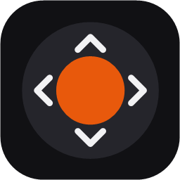
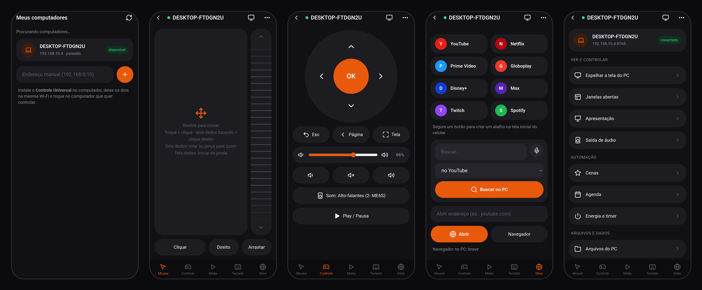
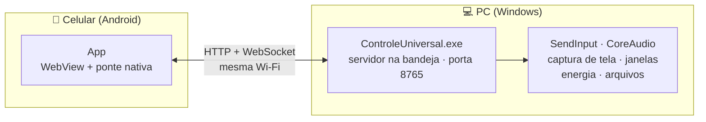

<div align="center">



# Controle Universal

**Transforme o celular no controle do seu PC.**<br>
Mouse, teclado, mídia, tela, arquivos, cenas e muito mais, pela sua Wi‑Fi, sem nuvem e sem conta.

[](https://github.com/carlosguilhe/controle-universal/releases/latest)
[](LICENSE)


### [⬇️ Baixar para o PC (.exe)](https://github.com/carlosguilhe/controle-universal/releases/latest/download/ControleUniversal.exe)   ·   [📱 Baixar para o Android (.apk)](https://github.com/carlosguilhe/controle-universal/releases/latest/download/ControleUniversal.apk)

<br>



</div>

---

## ✨ Por que usar

- **Zero configuração de rede.** O app procura o PC sozinho na Wi‑Fi e o reencontra se o IP mudar. Nada de reservar IP no roteador.
- **Tudo local.** Celular e PC conversam direto pela sua rede. Não existe servidor, conta nem telemetria.
- **Um arquivo só no PC.** O `ControleUniversal.exe` é programa, instalador e desinstalador. Não precisa instalar nada além dele.
- **Pensado para a TV.** Abre Netflix, YouTube e outros em tela cheia no navegador, controla volume, áudio e energia. Ótimo para PC ligado na TV.
- **Escuro, claro ou automático**, com interface em português.

## 🚀 Instalação em 2 minutos

**1. No PC (Windows 10 ou 11)**
1. Baixe o [`ControleUniversal.exe`](https://github.com/carlosguilhe/controle-universal/releases/latest/download/ControleUniversal.exe) e dê dois cliques.
2. Escolha **Sim** para instalar e aceite o pedido de administrador (ele só libera a porta no firewall).
3. O programa fica perto do relógio, abre com o Windows e mostra o **painel com o código de pareamento**.

**2. No celular (Android 7 ou mais novo)**
1. Baixe o [`ControleUniversal.apk`](https://github.com/carlosguilhe/controle-universal/releases/latest/download/ControleUniversal.apk), ou aponte a câmera para o QR Code da seção **"Instalar o app no celular"** do painel do PC.
2. Permita a instalação de apps desta fonte quando o Android pedir.

**3. Conectar**
Abra o app, toque no seu PC e digite o código de 6 números do painel. Só na primeira vez.

> [!NOTE]
> O `.exe` e o `.apk` não são assinados por uma empresa certificadora, então o Windows (SmartScreen) e o Android (Play Protect) podem avisar que o app é "desconhecido". Em **Mais informações → Executar assim mesmo** (Windows) e **Instalar mesmo assim** (Android) o app instala normalmente. Confira os hashes `SHA-256` na página da [release](https://github.com/carlosguilhe/controle-universal/releases/latest) se quiser ter certeza de que o arquivo é o original.

## 🧩 O que dá para fazer

| | Recursos |
|---|---|
| 🖱️ **Mouse** | Touchpad com aceleração, faixa de rolagem com um dedo, clique direito, arrastar, pinça para zoom, três dedos para trocar de janela, sensibilidade ajustável |
| 🎮 **Controle remoto** | Direcional com OK, Esc, voltar página, tela cheia, volume real do PC com barra, troca da saída de áudio (alto‑falantes, TV/HDMI, fone) e brilho em notebooks |
| 🎬 **Mídia** | Play/pausa, faixa anterior/próxima, "tocando agora" com título e progresso, atalhos de vídeo (tela cheia, mudo, legenda) |
| ⌨️ **Teclado** | Digitação ao vivo, ditado por voz, teclado completo (Ctrl, Alt, Shift, Win, F1–F12), atalhos de edição e do Windows |
| 🌐 **Sites** | Adicione e remova sites direto na aba, com catálogo de serviços populares ou endereço próprio. Cada botão mostra o **logo do site** (o PC busca e guarda o ícone; sem ícone, fica a letra inicial). Busca no YouTube, Google, Netflix e Spotify e atalhos na tela inicial do Android |
| ⭐ **Cenas** | Receitas de vários passos com um toque. Exemplo: abrir a Netflix, esperar 3 s, volume em 40% e apagar a tela |
| 📅 **Agenda** | Executa uma cena, abre um site ou desliga o PC em um horário (uma vez ou todos os dias) |
| 🖥️ **Espelho de tela** | Veja o PC no celular e toque para clicar. Vários monitores, zoom, rolagem e qualidade ajustável |
| 🪟 **Janelas** | Lista as janelas abertas para trazer para a frente, minimizar ou fechar |
| 📂 **Arquivos** | Navegue pelas pastas do PC, abra no PC ou baixe para o celular. Envie arquivos do celular pelo menu **Compartilhar** |
| 🔗 **Compartilhar links** | Em qualquer app, **Compartilhar → Controle Universal** abre o link no navegador do PC |
| 📋 **Área de transferência** | Copie texto do celular para o PC e do PC para o celular |
| 🎤 **Apresentação** | Setas grandes, tela preta, cronômetro e ponteiro para slides |
| ⚡ **Energia** | Bloquear, apagar a tela, suspender, reiniciar, desligar e timer de desligamento |
| 🔔 **Extras** | Controle pela barra de notificações, botões de volume do celular controlam o PC, ligar o PC (Wake‑on‑LAN) |

## 🔒 Segurança

- Só consegue controlar o PC quem digita o **código de 6 números** mostrado no próprio PC. Cinco erros bloqueiam por 1 minuto.
- Cada celular pareado recebe uma chave própria, guardada só como *hash* no PC. No painel você vê os celulares e remove qualquer um.
- O **painel** (código, configurações) só abre no próprio PC.
- A conexão é **HTTP/WebSocket dentro da sua rede, sem criptografia**. Use em rede de casa em que você confia.
- Janelas abertas "como administrador" não recebem mouse e teclado do programa (limite do Windows).

## 🛠️ Como funciona



- **PC:** um único executável em C# (.NET Framework, que já vem no Windows) com servidor HTTP/WebSocket próprio, ícone na bandeja e instalador embutido. Compila só com o `csc.exe` do Windows.
- **Celular:** app Android com a interface em HTML/JS dentro de um `WebView`, mais uma ponte nativa para voz, notificações, atalhos, envio e download de arquivos e Wake‑on‑LAN. Compilado sem Gradle.
- Protocolo documentado em [`docs/PROTOCOLO.md`](docs/PROTOCOLO.md).

## 🧱 Compilar do código‑fonte

**PC** (precisa só do Windows 10/11):

```powershell
.\construir.ps1          # gera saida\ControleUniversal.exe
```

**Android** (precisa de JDK 17 e do Android SDK com *build‑tools* 34 e *platform* android‑34):

```powershell
.\android\construir-apk.ps1            # gera android\saida\ControleUniversal.apk
.\android\construir-apk.ps1 -Instalar  # e instala no celular ligado por adb
```

Para o APK vir embutido no `.exe` (o PC passa a entregar o app em `/app.apk`), compile o APK **antes** do `.exe`.

> [!IMPORTANT]
> Na primeira compilação do APK é criada a chave `android/chave.jks`. Ela **não vai para o Git** (veja o `.gitignore`). Guarde um backup: sem ela, uma atualização exige desinstalar o app antes.

## 🗂️ Estrutura

```
controle-universal/
├── fonte/
│   ├── ControleUniversal.cs   servidor, entrada (mouse/teclado), navegador, bandeja
│   ├── Extras.cs              áudio, cenas, agenda, arquivos, instalador
│   ├── icone.ico
│   └── web/                   painel do PC (HTML) e biblioteca de QR Code
├── android/
│   ├── assets/index.html      interface do app
│   ├── src/                   ponte nativa (Java)
│   ├── res/ · AndroidManifest.xml
│   └── construir-apk.ps1
├── docs/                      imagens e protocolo
├── construir.ps1
└── LICENSE
```

## 🗺️ Próximos passos

- [ ] Conexão criptografada (HTTPS/WSS)
- [ ] Código de pareamento que expira e aviso no PC quando um celular novo conecta
- [ ] Descoberta do PC ainda mais rápida (mDNS/UDP)
- [ ] Acesso de fora de casa (por exemplo, via Tailscale)

Ideias e problemas são bem‑vindos nas [issues](https://github.com/carlosguilhe/controle-universal/issues).

## 📄 Licença

[MIT](LICENSE). A biblioteca de QR Code [`qrcode-generator`](https://github.com/kazuhikoarase/qrcode-generator) (MIT) acompanha o projeto em `fonte/web/qrcode.js`.
